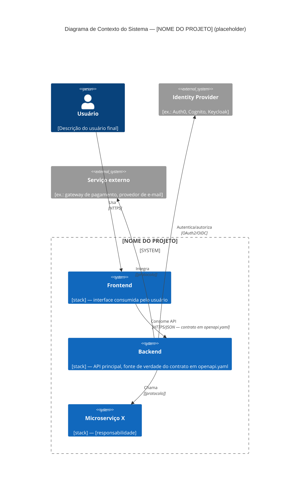

# Arquitetura do Sistema — [NOME DO PROJETO]

> **Status:** esqueleto/placeholder. Este documento é preenchido durante o
> processo de setup inicial descrito em `BOOTSTRAP.md`. Até lá, as seções
> abaixo contêm apenas a estrutura esperada.

## Visão geral

[Uma ou duas frases descrevendo o que o sistema faz e para quem, em nível de
negócio — não de implementação.]

## Repositórios do projeto

| Repositório | Responsabilidade | Linguagem/stack | Link |
|---|---|---|---|
| `[org]/[backend]` | [ex.: API principal, regras de negócio, persistência] | [stack] | [link] |
| `[org]/[frontend]` | [ex.: interface web] | [stack] | [link] |
| `[org]/[microservice-x]` | [responsabilidade] | [stack] | [link] |

Este repositório (`docs/shared`) não roda código de aplicação. Ele existe
para conter o que é compartilhado entre os repositórios acima e não pertence
a nenhum isoladamente: contrato de API, decisões de arquitetura e
vocabulário de domínio.

## Diagrama de arquitetura (C4 — Nível 1: Contexto)

> Placeholder. Substituir pelos sistemas e atores reais do projeto ao
> concluir o bootstrap.

## Autenticação e autorização entre serviços

[Descrever aqui, ao concluir o bootstrap:]

- Como o usuário se autentica no frontend.
- Como o frontend se autentica contra o backend (ex.: JWT em header
  `Authorization`, cookies de sessão, etc.).
- Como os serviços internos (backend ↔ microservices) se autenticam entre si
  (ex.: mTLS, tokens de serviço, API keys internas).
- Onde ficam as chaves/segredos usados nesse fluxo (não documentar valores,
  apenas onde são gerenciados — ex.: secret manager do provedor cloud).

## Decisões de arquitetura relevantes

Decisões que afetam mais de um repositório ficam registradas em
[`docs/adr/`](docs/adr/), começando por
[`0001-registro-de-decisoes.md`](docs/adr/0001-registro-de-decisoes.md).

## Como este documento se relaciona com os repositórios individuais

Cada repositório (`backend`, `frontend`, microservices) pode manter seu
próprio `ARCHITECTURE.md` interno para detalhes de implementação. Este
documento aqui cobre apenas o que atravessa fronteiras de repositório. Em
caso de conflito sobre uma decisão que afeta múltiplos repositórios, este
documento (e as ADRs centralizadas) prevalece.
