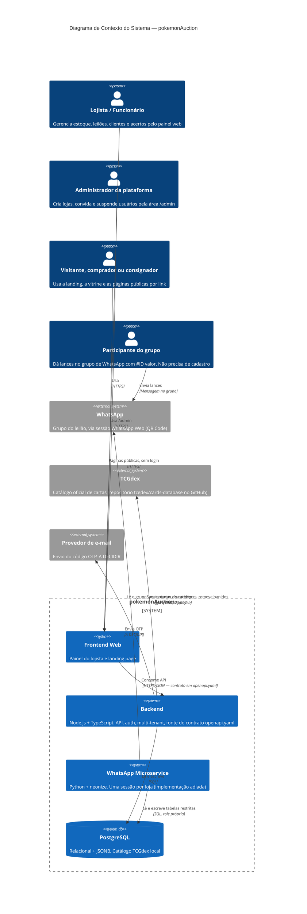

# Arquitetura do Sistema — pokemonAuction

> **Nome provisório.** O produto ainda vai ganhar um nome definitivo. Quando
> isso acontecer, troque aqui, em `README.md`, em `GLOSSARY.md` e nos
> `README.md` dos demais repositórios.

## Visão geral

Plataforma SaaS B2B multi-tenant para lojistas de Trading Card Games
(Pokémon, entre outros) realizarem leilões de cartas em grupos de WhatsApp.
O sistema cuida do estoque (próprio e consignado), do disparo automático da
carta no grupo, da leitura em tempo real dos lances, do fechamento (acerto)
e da moderação da comunidade. Cada loja é um tenant com dados 100% isolados.

Estágio: produto novo, MVP enxuto. O escopo de produto completo (papéis, regras e mapa de telas) está em [`docs/produto.md`](docs/produto.md). Sem gateway de pagamento e sem gestão de
envio nesta fase (ver [ADR 0002](docs/adr/0002-mvp-sem-pagamento-e-sem-envio.md)).

## Repositórios do projeto

| Repositório | Responsabilidade | Linguagem/stack | Link |
|---|---|---|---|
| `Project-PKA/Backend` | API principal, regras de negócio, auth, persistência e **dono das migrations** | Node.js + TypeScript, PostgreSQL, Drizzle | [repo](https://github.com/Project-PKA/Backend) |
| `Project-PKA/frontend_web` | Painel web do lojista e landing page | A DECIDIR (ver `frontend_web/BOOTSTRAP.md`) | [repo](https://github.com/Project-PKA/frontend_web) |
| `Project-PKA/whatsapp_microservice` | Sessões de WhatsApp por QR Code: leitura de lances, disparo e encerramento no grupo, moderação | Python 3.10+ e neonize ([ADR 0015](docs/adr/0015-bot-em-python-com-neonize.md)); implementação adiada | [repo](https://github.com/Project-PKA/whatsapp_microservice) |
| `Project-PKA/shared` | Contrato de API, ADRs cross-repo, glossário | Documentação | [repo](https://github.com/Project-PKA/shared) |

Este repositório (`docs/shared`) não roda código de aplicação. Ele existe
para conter o que é compartilhado entre os repositórios acima e não pertence
a nenhum isoladamente: contrato de API, decisões de arquitetura e
vocabulário de domínio.

## Diagrama de arquitetura (C4 — Nível 1: Contexto)

## Responsabilidades e fronteiras

- **Backend** é o único dono do schema. Toda migration nasce e roda lá. Ele
  expõe a API sob `/v1`, aplica o isolamento por loja e o RBAC e executa o
  sync do catálogo TCGdex.
- **WhatsApp Microservice** só cuida da conversa com o WhatsApp e do que
  precisa acontecer na hora (aceitar lance, abrir e fechar leilão no
  horário). Acessa o banco com role própria, restrita às tabelas listadas em
  [ADR 0007](docs/adr/0007-banco-compartilhado-e-sessao-whatsapp-por-qr-code.md).
- **Frontend** nunca fala com o microservice. Tudo passa pela API do Backend.

## Autenticação e autorização entre serviços

- **Usuário no frontend:** login passwordless. Informa o e-mail e recebe um
  código OTP numérico por e-mail. O OTP é guardado como hash, com expiração e
  limite de tentativas (ver [ADR 0008](docs/adr/0008-autenticacao-passwordless-e-multi-tenant.md)).
- **Frontend contra Backend:** access JWT de vida curta no header
  `Authorization`, com refresh token em cookie `httpOnly`, rotacionado. Toda rota autenticada, exceto
  a de seleção de loja, exige o header `x-store-id`; o Backend valida em
  `store_members` e filtra tudo por `store_id`.
- **Acesso por convite:** não há cadastro aberto. Contas nascem por convite
  ou pelo administrador da plataforma, que não altera dados internos das lojas
  ([ADR 0012](docs/adr/0012-acesso-somente-por-convite-e-administracao-da-plataforma.md)).
- **Páginas públicas** (vitrine, acerto do cliente, acompanhamento do
  consignador) usam token de alta entropia no link, limite de tentativas e
  funções de banco restritas, nunca a sessão de um usuário
  ([ADR 0014](docs/adr/0014-paginas-publicas-por-link-e-vitrine.md)).
- **Papéis:** `OWNER` (acesso total) e `STAFF` (padrão: tudo, exceto deletar),
  com permissões finas em JSONB. Um e-mail pode pertencer a várias lojas, com
  dados isolados.
- **Isolamento entre lojas:** além do filtro por `store_id` no código, o
  PostgreSQL aplica Row-Level Security por transação
  ([ADR 0011](docs/adr/0011-row-level-security-como-segunda-barreira.md)).
- **Backend e microservice:** compartilham o banco, cada um com sua role.
  Chamadas diretas entre os dois (ex.: "reconectar sessão") ainda não foram
  decididas; se existirem, vira ADR.
- **Segredos:** não documentar valores. A sessão do WhatsApp
  (`whatsapp_sessions.session_data`, tabela própria) é credencial e deve ficar criptografada em
  repouso. O local dos demais segredos de produção é decidido no
  `Backend/BOOTSTRAP.md`, etapa 8.

## Riscos aceitos

- **Banimento do número.** A conexão por QR Code (WhatsApp Web) não é a API
  oficial e pode violar os termos do WhatsApp. O risco foi aceito para manter
  o custo de mensageria em zero (ver ADR 0007).
- **LGPD.** O sistema guarda CPF, endereço, telefone e e-mail de terceiros.
  Pendente: base legal, retenção e exclusão. Resolver antes de ter loja real.
- **Superfícies públicas com dado de terceiros.** A página do consignador usa
  uma chave fraca (4 dígitos do CPF) e a vitrine expõe o link do grupo de
  WhatsApp da loja. Mitigações obrigatórias na ADR 0014; o link do grupo é
  risco aceito pela loja ao ativar a vitrine.
- **Posição jurídica da plataforma.** Ela não vende nem garante pagamento ou
  entrega ([ADR 0013](docs/adr/0013-plataforma-nao-vende-nem-garante-pagamento-ou-entrega.md)).
  Termos de uso e Política de Privacidade precisam de revisão jurídica.
- **Concorrência de lances.** Dois lances quase simultâneos na mesma carta
  precisam de regra determinística para decidir o maior. Decidir no schema,
  antes do motor de leilões, e registrar em ADR.

## Decisões de arquitetura relevantes

Decisões que afetam mais de um repositório ficam registradas em
[`docs/adr/`](docs/adr/), começando por
[`0001-registro-de-decisoes.md`](docs/adr/0001-registro-de-decisoes.md).

## Como este documento se relaciona com os repositórios individuais

Cada repositório pode manter seu próprio `ARCHITECTURE.md` interno para
detalhes de implementação. Este documento aqui cobre apenas o que atravessa
fronteiras de repositório. Em caso de conflito sobre uma decisão que afeta
múltiplos repositórios, este documento (e as ADRs centralizadas) prevalece.
